# Advanced Governance & Roles Walkthroughs

This guide provides step-by-step visual walkthroughs (animated SVG and GIF), runnable `stellar contract invoke` commands, expected outputs, and troubleshooting notes for Accord Protocol's advanced governance features:

1. [Walkthrough 1: RBAC & Roles Management](#walkthrough-1-rbac--roles-management)
2. [Walkthrough 2: Weighted Approvals & Quorum](#walkthrough-2-weighted-approvals--quorum)
3. [Walkthrough 3: Vote Delegation & Effective Weight](#walkthrough-3-vote-delegation--effective-weight)
4. [Walkthrough 4: Recurring Payments Governance](#walkthrough-4-recurring-payments-governance)

> **Prerequisites:** Set `CONTRACT_ID`, `NETWORK=testnet`, and an owner identity (`OWNER_ALIAS`) configured in Stellar CLI. See [Development Setup](../SETUP.md) and [Contract API Reference](../CONTRACT_API.md).

---

## Walkthrough 1: RBAC & Roles Management

Grant and revoke `Proposer`, `Approver`, `Executor`, and `Viewer` roles to enforce separation of duties across treasury signers.


> **GIF Alternative:** [`docs/assets/walkthroughs/06-rbac-roles-management.gif`](../assets/walkthroughs/06-rbac-roles-management.gif)

### Runnable Commands & Expected Output

1. **Inspect an owner's current roles:**
   ```bash
   stellar contract invoke \
     --id "$CONTRACT_ID" \
     --network testnet \
     --source "$OWNER_ALIAS" \
     -- get_roles \
     --address "$TARGET_OWNER"
   ```
   **Expected output:**
   ```json
   ["Proposer", "Approver"]
   ```

2. **Propose granting the `Executor` role:**
   ```bash
   stellar contract invoke \
     --id "$CONTRACT_ID" \
     --network testnet \
     --source "$OWNER_ALIAS" \
     -- create_grant_role_proposal \
     --proposer "$OWNER_ADDRESS" \
     --target "$TARGET_OWNER" \
     --role Executor \
     --description "Grant Executor role to ops signer" \
     --deadline 1795000000
   ```
   **Expected output:**
   ```text
   24
   ```
   *(Returns the new proposal ID, e.g. `24`.)*

3. **Verify after quorum approval and execution:**
   ```bash
   stellar contract invoke \
     --id "$CONTRACT_ID" \
     --network testnet \
     --source "$OWNER_ALIAS" \
     -- has_role \
     --address "$TARGET_OWNER" \
     --role Executor
   ```
   **Expected output:**
   ```json
   true
   ```

### Troubleshooting Notes
- **`MissingRole` (`#52`):** The caller does not hold the required role (`Proposer`, `Approver`, or `Executor`). Run `get_roles` to verify assignments.
- **`RoleAlreadyGranted` (`#53`) / `RoleNotGranted` (`#54`):** You tried to grant a role the address already holds, or revoke one it does not hold.
- **`InvalidRole` (`#55`):** Only `Proposer`, `Approver`, `Executor`, and `Viewer` are valid `Role` variants.

*Related guide:* [Roles & Permissions](roles-and-permissions.md)

---

## Walkthrough 2: Weighted Approvals & Quorum

Configure unequal voting weights for owners while preserving Accord's 50% single-owner weight cap (`MAX_SINGLE_OWNER_WEIGHT_PCT = 50`).


> **GIF Alternative:** [`docs/assets/walkthroughs/07-weighted-approvals-quorum.gif`](../assets/walkthroughs/07-weighted-approvals-quorum.gif)

### Runnable Commands & Expected Output

1. **Inspect current owner weights and total weight:**
   ```bash
   stellar contract invoke \
     --id "$CONTRACT_ID" \
     --network testnet \
     --source "$OWNER_ALIAS" \
     -- get_owner_weights
   ```
   **Expected output:**
   ```json
   [
     { "owner": "GABC...1111", "weight": 40 },
     { "owner": "GDEF...2222", "weight": 30 },
     { "owner": "GHIJ...3333", "weight": 30 }
   ]
   ```

2. **Check the total weight and maximum single-owner cap:**
   ```bash
   stellar contract invoke \
     --id "$CONTRACT_ID" \
     --network testnet \
     --source "$OWNER_ALIAS" \
     -- get_total_weight
   ```
   **Expected output:**
   ```text
   100
   ```

3. **Propose changing an owner's weight:**
   ```bash
   stellar contract invoke \
     --id "$CONTRACT_ID" \
     --network testnet \
     --source "$OWNER_ALIAS" \
     -- create_change_weight_proposal \
     --proposer "$OWNER_ADDRESS" \
     --target "$TARGET_OWNER" \
     --new_weight 25 \
     --description "Rebalance voting weight to 25" \
     --deadline 1795000000
   ```
   **Expected output:**
   ```text
   25
   ```

### Troubleshooting Notes
- **`SingleOwnerWeightCapExceeded` (`#46`):** The proposed `new_weight` would give one owner more than `50%` of `total_weight`. Lower the weight or increase other owners' weights first.
- **`WouldBreakQuorum` (`#48`):** Reducing `total_weight` would make the current `threshold` unreachable. Lower `threshold` via `create_change_threshold_proposal` first.
- **`WeightBelowMinimum` (`#43`):** Every owner weight must be at least `MIN_OWNER_WEIGHT` (`1`).

*Related guide:* [Choosing Voting Weights](weighted-governance.md)

---

## Walkthrough 3: Vote Delegation & Effective Weight

Delegate voting weight when an owner is temporarily unavailable and verify effective quorum power before voting.



> **GIF Alternative:** [`docs/assets/walkthroughs/08-vote-delegation.gif`](../assets/walkthroughs/08-vote-delegation.gif)

### Runnable Commands & Expected Output

1. **Inspect active delegations across the multisig:**
   ```bash
   stellar contract invoke \
     --id "$CONTRACT_ID" \
     --network testnet \
     --source "$OWNER_ALIAS" \
     -- get_active_delegations
   ```
   **Expected output:**
   ```json
   [
     { "delegator": "GABC...1111", "delegate": "GDEF...2222", "weight": 30 }
   ]
   ```

2. **Check an owner's delegation details and effective weight:**
   ```bash
   stellar contract invoke \
     --id "$CONTRACT_ID" \
     --network testnet \
     --source "$OWNER_ALIAS" \
     -- get_effective_weight \
     --owner "$DELEGATE_ADDRESS"
   ```
   **Expected output:**
   ```text
   55
   ```
   *(Delegate's own weight `25` + delegated weight `30` = `55`.)*

3. **Approve a proposal using the delegate's combined weight:**
   ```bash
   stellar contract invoke \
     --id "$CONTRACT_ID" \
     --network testnet \
     --source "$DELEGATE_ALIAS" \
     -- approve \
     --approver "$DELEGATE_ADDRESS" \
     --proposal_id 26
   ```

### Troubleshooting Notes
- **`Unauthorized` (`#3`) or `AlreadyApproved` (`#8`):** A delegator cannot double-vote after delegating their weight, and a delegate cannot approve the same proposal twice.
- **`OwnerNotFound` (`#25`):** Both delegator and delegate must be current multisig owners.

---

## Walkthrough 4: Recurring Payments Governance

Create, disburse, pause, resume, and cancel recurring treasury payment schedules.


> **GIF Alternative:** [`docs/assets/walkthroughs/09-recurring-payments-governance.gif`](../assets/walkthroughs/09-recurring-payments-governance.gif)

### Runnable Commands & Expected Output

1. **Create a recurring payment proposal (30-day interval = `2592000` seconds):**
   ```bash
   stellar contract invoke \
     --id "$CONTRACT_ID" \
     --network testnet \
     --source "$OWNER_ALIAS" \
     -- create_recurring_proposal \
     --proposer "$OWNER_ADDRESS" \
     --recipient "$RECIPIENT_ADDRESS" \
     --token "$USDC_TOKEN_ADDRESS" \
     --amount 20000000000 \
     --interval 2592000 \
     --total_cap 240000000000 \
     --description "Monthly contributor retainer" \
     --deadline 1795000000
   ```
   **Expected output:**
   ```text
   27
   ```

2. **Check when the next disbursement is due:**
   ```bash
   stellar contract invoke \
     --id "$CONTRACT_ID" \
     --network testnet \
     --source "$OWNER_ALIAS" \
     -- get_next_disbursement_time \
     --schedule_id 4
   ```
   **Expected output:**
   ```text
   1797592000
   ```

3. **Trigger a due disbursement (permissionless):**
   ```bash
   stellar contract invoke \
     --id "$CONTRACT_ID" \
     --network testnet \
     --source "$OWNER_ALIAS" \
     -- disburse_recurring \
     --schedule_id 4
   ```

4. **Emergency pause a recurring schedule:**
   ```bash
   stellar contract invoke \
     --id "$CONTRACT_ID" \
     --network testnet \
     --source "$OWNER_ALIAS" \
     -- create_pause_recurring_proposal \
     --proposer "$OWNER_ADDRESS" \
     --schedule_id 4 \
     --description "Pause schedule #4 pending contract renewal" \
     --deadline 1795000000
   ```

### Troubleshooting Notes
- **`RecurringIntervalNotElapsed` (`#36`) / `RecurringPaymentNotDue` (`#33`):** Wait until `ledger_timestamp >= get_next_disbursement_time(schedule_id)`.
- **`ScheduleAlreadyPaused` (`#39`) / `ScheduleNotPaused` (`#40`):** Verify schedule status with `get_recurring_payment` before submitting pause/resume proposals.
- **`ScheduleTerminal` (`#41`):** Cancelled or completed schedules cannot be resumed or modified.
- **`TooManyActiveRecurring` (`#37`):** The contract caps active recurring schedules at `MAX_ACTIVE_RECURRING` (`20`).

*Related guides:* [Payroll with Recurring Payments](payroll-recurring.md) | [Treasury Policy Operator Playbook](treasury-policy-playbook.md) | [Error-Code & Troubleshooting Index](../ERROR_CODES.md)
